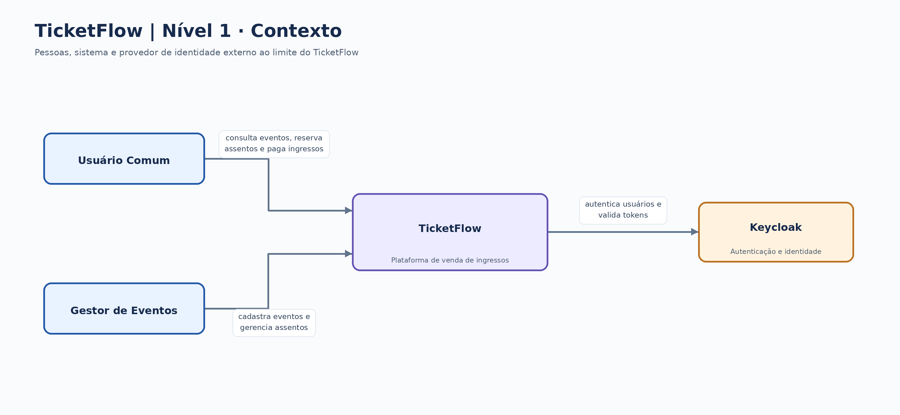
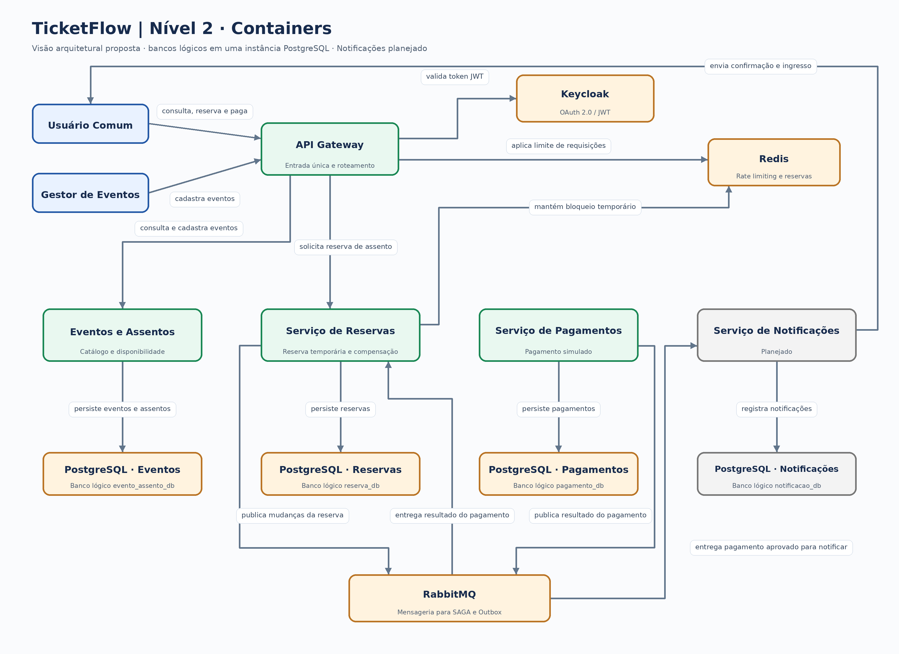

# Projeto Final: Engenharia de Sistemas Distribuídos

## Equipe
1. Herick de Lima Carneiro
2. João Victor Lourenço da Silva
3. Luana de Méro Omena
4. Luerson de Albuquerque Silva Filho
5. João Lucas Félix de Macena
6. Leandeson Pinheiro Santos de Araújo

## TicketFlow

## Estrutura do Projeto (Microsserviços)
Cada serviço contará com seu próprio schema de banco de dados, com migrações gerenciadas via **Flyway**, e mapeamento de objetos utilizando **MapStruct**. A orquestração do ambiente local será feita via **Docker Compose**.

- `/api-gateway`: Ponto de entrada único para o sistema.
- `/evento-assento-service`: Serviço que gerencia eventos no sistema.
- `/reserva-service`: Serviço de reserva de assentos.
- `/pagamento-service`: Serviço que irá gerenciar/simular os pagamentos dos ingressos.

## Arquitetura

Os diagramas mostram a arquitetura proposta do TicketFlow em dois níveis. O nível 1 apresenta as pessoas e o provedor de identidade que se relacionam com o sistema. O nível 2 detalha os serviços e a infraestrutura. Os quatro bancos lógicos mostrados no nível 2 compartilham uma instância PostgreSQL, conforme `docker-compose.yml` e `init.sql`. O Serviço de Notificações está previsto na proposta do projeto, mas ainda não está implementado neste repositório.

### Nível 1 — Contexto

[Fonte editável no draw.io](docs/arquitetura/c4-nivel1.drawio)
### Nível 2 — Containers

[Fonte editável no draw.io](docs/arquitetura/c4-nivel2.drawio)

## Executando o Ambiente Local
Para subir a infraestrutura de dependências (bancos de dados, message brokers, etc):
\`\`\`bash
docker-compose up -d
\`\`\`

---

## Declaração Obrigatória: Ferramentas de IA utilizadas

* **Ferramentas utilizadas:**
* **Em quais partes do trabalho a IA atuou:**
* **Como a IA foi orientada:**
* **Avaliação do uso da IA:**
