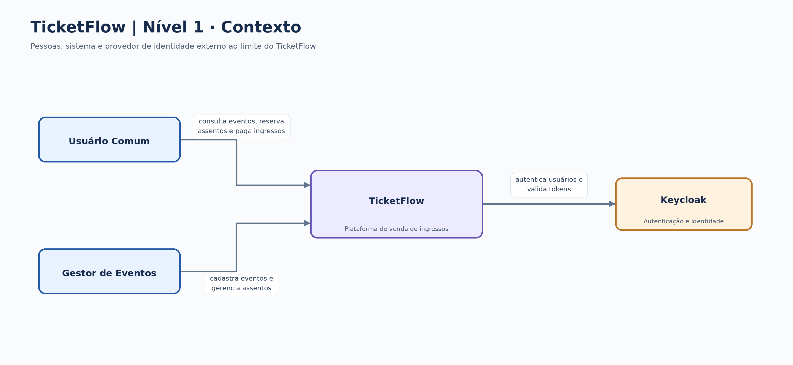
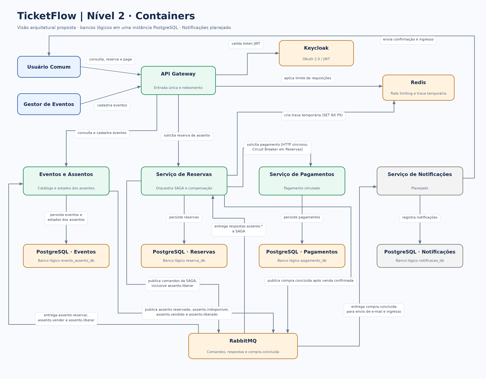

# Projeto Final: Engenharia de Sistemas Distribuídos

## Equipe

| Integrante | GitHub |
| :--- | :--- |
| Herick de Lima Carneiro | [herickcarneiro](https://github.com/herickcarneiro) |
| João Lucas Félix de Macena | [Joao-lucas-felix](https://github.com/Joao-lucas-felix) |
| João Victor Lourenço da Silva | [jovilourenco](https://github.com/jovilourenco) |
| Leandeson Pinheiro Santos de Araújo | [LeandPin](https://github.com/LeandPin) |
| Luana de Méro Omena | [Luanamero](https://github.com/Luanamero) |
| Luerson de Albuquerque Silva Filho | [Luerson](https://github.com/Luerson) |

## Tema Escolhido

**TicketFlow: Plataforma Distribuída de Venda de Ingressos com Reserva de Assentos.** O tema é "venda de ingressos com reserva de assentos", um dos disponibilizados na descrição do projeto final.

O TicketFlow trata do momento de abertura de vendas de um evento, quando milhares de pessoas disputam os mesmos assentos ao mesmo tempo. Sem o devido controle, o sistema pode vender um assento mais de uma vez, cobrar em dobro quando o cliente repete o clique ou a rede falha, e deixar dados inconsistentes se um serviço cair no meio da compra.

A solução é uma arquitetura de microsserviços com foco em **segurança** e **confiabilidade**. A [proposta do projeto](docs/Proposta%20para%20Projeto%20Final%20-%20Eng.%20Sist.%20Distribu%C3%ADdos-2.pdf) define as metas a seguir, que ainda serão verificadas com os testes de carga e resiliência previstos nela:

- nenhum assento vendido em duplicidade com 500 usuários simultâneos;
- nenhuma cobrança duplicada em requisições repetidas com a mesma chave de idempotência;
- liberação automática de reservas não pagas em até 10 minutos;
- latência p95 da reserva abaixo de 300 ms com 200 requisições por segundo;
- erro controlado em menos de 1 segundo quando o Serviço de Pagamentos estiver indisponível;
- nenhum evento perdido ao derrubar um serviço durante a publicação de mensagens;
- compensação em 100% das reservas cujo pagamento falhar.

## Estrutura do Projeto

```text
.
├── evento-assento-service/   # Catálogo de eventos e estados dos assentos
├── reserva-service/          # Reserva de ingressos e orquestração da SAGA de compra
├── pagamento-service/        # Pagamento simulado, com idempotência
├── docs/                     # Proposta, ADRs, diagramas, documentação e slides
├── .github/workflows/ci.yml  # Build, testes e análise no SonarQube Cloud
├── docker-compose.yml        # Infraestrutura local
├── init.sql                  # Criação dos bancos lógicos de cada serviço
└── .env.example              # Modelo das variáveis de ambiente
```

Cada serviço tem o seu próprio banco lógico, com migrações gerenciadas por **Flyway** e mapeamento de objetos com **MapStruct**.

### Situação dos serviços

A arquitetura descreve o sistema completo planejado. A implementação ainda está em andamento:

| Serviço | Situação |
| :--- | :--- |
| Eventos e Assentos | Eventos e assentos implementados; os assentos têm testes de integração. A participação na SAGA pelo RabbitMQ está no PR [#40](https://github.com/jovilourenco/projeto-eng_sistemas_distribuidos/pull/40). |
| Reservas | Estrutura inicial. Ingressos e trava no Redis estão em andamento nas issues [#12](https://github.com/jovilourenco/projeto-eng_sistemas_distribuidos/issues/12), [#28](https://github.com/jovilourenco/projeto-eng_sistemas_distribuidos/issues/28) e [#34](https://github.com/jovilourenco/projeto-eng_sistemas_distribuidos/issues/34). |
| Pagamentos | Estrutura inicial. |
| API Gateway | Planejado; a pasta do serviço ainda não existe. |
| Notificações | Planejado; a pasta do serviço ainda não existe, mas o banco `notificacao_db` já é criado. |

## Arquitetura

Os diagramas mostram a arquitetura proposta do TicketFlow em dois níveis. O nível 1 apresenta as pessoas e o provedor de identidade que se relacionam com o sistema. O nível 2 detalha os serviços e a infraestrutura. Os quatro bancos lógicos do nível 2 compartilham uma instância PostgreSQL, conforme [docker-compose.yml](docker-compose.yml) e [init.sql](init.sql).

### Nível 1: Contexto



[Fonte editável no draw.io](docs/arquitetura/c4-nivel1.drawio)

### Nível 2: Containers



[Fonte editável no draw.io](docs/arquitetura/c4-nivel2.drawio)

### Decisões arquiteturais

| ADR | Decisão |
| :--- | :--- |
| [ADR-001: Broker de mensagens](docs/adr/ADR-001-broker-de-mensagens.md) | RabbitMQ, com filas duráveis, mensagens persistentes e filas de mensagens mortas. |
| [ADR-002: Coordenação da SAGA de compra](docs/adr/ADR-002-saga-orquestrada-pelo-servico-de-reservas.md) | SAGA orquestrada pelo Serviço de Reservas; pagamento por HTTP com Circuit Breaker e chave de idempotência. |
| [ADR-003: Fonte da verdade do status do assento](docs/adr/ADR-003-fonte-da-verdade-do-status-do-assento.md) | PostgreSQL do Serviço de Eventos e Assentos como fonte da verdade; Redis apenas como filtro de entrada. |

O [índice de ADRs](docs/adr/README.md) traz também o modelo e os próximos ADRs previstos.

## Documentação

| Documento | Conteúdo |
| :--- | :--- |
| [Proposta do projeto](docs/Proposta%20para%20Projeto%20Final%20-%20Eng.%20Sist.%20Distribu%C3%ADdos-2.pdf) | Tema, critérios de sucesso e plano de testes |
| [Stack tecnológica](docs/stack.md) | Tecnologias usadas e por que foram escolhidas |
| [Padrões arquiteturais](docs/padroes.md) | Onde cada padrão é aplicado e qual problema resolve |
| [Responsabilidades](docs/responsabilidades.md) | Divisão de tarefas da equipe |
| [Contrato de mensagens](docs/mensageria.md) | Topologia no RabbitMQ e mensagens da SAGA |
| [Slides da apresentação](docs/slides/) | Apresentação da Entrega 2, em preparação na issue [#19](https://github.com/jovilourenco/projeto-eng_sistemas_distribuidos/issues/19) |

## Arquitetura

Os diagramas mostram a arquitetura proposta do TicketFlow em dois níveis. O nível 1 apresenta as pessoas e o provedor de identidade que se relacionam com o sistema. O nível 2 detalha os serviços e a infraestrutura. Os quatro bancos lógicos mostrados no nível 2 compartilham uma instância PostgreSQL, conforme `docker-compose.yml` e `init.sql`. O Serviço de Notificações está previsto na proposta do projeto, mas ainda não está implementado neste repositório.

### Nível 1 — Contexto


[Fonte editável no draw.io](docs/arquitetura/c4-nivel1.drawio)
### Nível 2 — Containers


[Fonte editável no draw.io](docs/arquitetura/c4-nivel2.drawio)

## Executando o Ambiente Local

**Pré-requisitos:** Docker com Docker Compose, JDK 17 e Maven.

### 1. Infraestrutura

Crie o arquivo `.env` a partir do modelo e preencha os valores:

```bash
cp .env.example .env
```

Depois, suba PostgreSQL, Redis, RabbitMQ e Keycloak:

```bash
docker compose up -d
docker compose ps
```

| Serviço | Endereço no computador |
| :--- | :--- |
| PostgreSQL | `localhost:5432` (configurável por `POSTGRES_PORT`) |
| Redis | `localhost:6379` |
| RabbitMQ | `localhost:5672`; painel em <http://localhost:15672> |
| Keycloak | <http://localhost:8081> |

O `init.sql` só é executado quando o volume do PostgreSQL é criado. Para recriar os bancos, use `docker compose down -v`, que **apaga os dados locais**, e suba o ambiente novamente.

### 2. Serviços

Todos os serviços e o Keycloak usam a porta `8081` por padrão. Por isso, defina uma porta livre com `SERVER_PORT` para cada serviço:

```bash
cd evento-assento-service
DB_PORT=5432 DB_USER=<usuario> DB_PASSWORD=<senha> SERVER_PORT=8090 mvn spring-boot:run
```

Use os mesmos valores de `DB_USER` e `DB_PASSWORD` do `.env`. Não defina `DB_NAME` nesse comando: cada serviço já aponta para o próprio banco por padrão.

### 3. Testes

Os testes de integração usam PostgreSQL real por meio de Testcontainers, portanto exigem o Docker em execução:

```bash
cd evento-assento-service
mvn test
```

O [pipeline de CI](.github/workflows/ci.yml) executa build, testes e análise no SonarQube Cloud para os três serviços em cada Pull Request para `main` ou `dev`.

## Como Contribuir

Abra os Pull Requests para a branch `dev`. **Todo PR deve trazer uma linha dizendo se usou IA e para quê**, inclusive quando a resposta for "não usei". Essas linhas alimentam a declaração abaixo.

---

## Declaração Obrigatória: Ferramentas de IA utilizadas

Esta seção compila as declarações de uso de IA feitas nas descrições dos Pull Requests que as trazem.

* **Ferramentas utilizadas:**
  * Claude;
  * Claude Code (Anthropic);
  * Codex, da OpenAI, com o modelo GPT-6 Sol utilizado na estilização visual dos diagramas;
  * DeepSeek.

* **Em quais partes do trabalho a IA atuou:** a IA foi utilizada para:
  * alterar o compose com o Keycloak, adicionar os healthchecks e depurar o conflito de porta;
  * diagnosticar o erro de build e sugerir e orientar a correção;
  * estruturar migração, entidade, camadas e testes;
  * leitura e síntese dos materiais do repositório, criação dos arquivos draw.io e exportação dos PNGs, atualização das referências no README, revisão da descrição do PR e integração com o GitHub para criar o PR, que foi posteriormente revisado;
  * estruturar e formatar `stack.md`, `padroes.md` e `responsabilidades.md` com base no PDF do projeto e na issue #18, e cruzar os dados textuais com os prints do GitHub para mapear as issues de cada integrante na tabela de responsabilidades;
  * levantamento das alternativas e análise comparativa, e redação dos ADRs a partir das decisões tomadas pela autora em sessões de perguntas e respostas (prós e contras de cada opção);
  * revisão do desenho por agentes avaliadores, que procuraram cenários de falha sem tratamento e lacunas em relação à proposta;
  * implementação do listener, do repositório, da configuração do RabbitMQ e dos testes, a partir dos ADRs, e redação do `docs/mensageria.md`;
  * revisão do código por agentes avaliadores (correção e qualidade), cujas sugestões foram aplicadas depois de verificadas.
